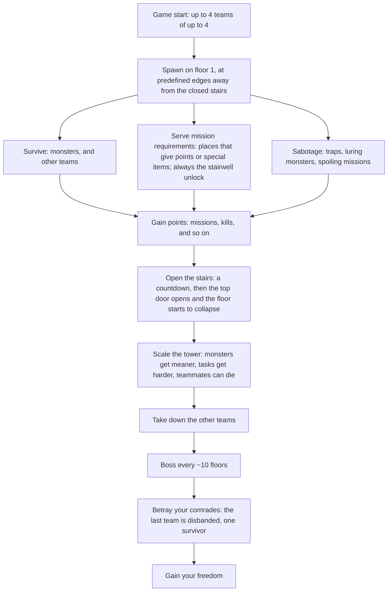

# The game loop

## The loop you drew

That is your graph, with the connections you listed (spawn to the three activities; the three to points; points to the stairs; the stairs to the climb; the climb to the other teams, the bosses, the betrayal and the freedom). One thing the graph does not show is that the cycle from "spawn" to "open the stairs" repeats on every floor; the last four boxes happen over many floors.

## A floor, step by step

**From you:** teams spawn in predefined edge rooms, away from the stairs, and the stairs area is closed. There are specific places generated on each floor that offer missions (for points or special items), and there is always the stairwell-unlocking mission, so a team can do it itself or wait for another team to do it and swoop in to take the prize. Some missions make particular monsters appear; some items are traps. When the stairs are opened there is a short countdown; when it ends the top door opens and the floor starts to collapse and the monsters get more vicious: get out or die.

**My reading, in order:**

1. **Arrive.** The floor is generated (the same seed for every player, so the server only sends the seed). Teams start in their rooms; the stairs, the mission sites and the safe-floor shop (if any) are placed.
2. **Scout and work.** Teams move toward mission sites, collect points and items, fight or avoid monsters, and each other. Noise and light decide what finds them (`03-monsters-and-senses.md`).
3. **The unlock mission.** One mission site, always present, unlocks the stairwell. Doing it takes time and effort and is visible and loud (a proposal: it is also announced on the broadcast, so everyone knows someone is on it, and it can be interrupted or sabotaged).
4. **The clock starts.** When the stairs are unlocked a countdown runs for the whole floor (proposal: 30 to 45 seconds at first, longer on bigger floors). During it the top door is still shut: this is the time to get near the stairs, set traps, or hold off the others.
5. **The door opens and the floor goes.** When the countdown ends the top door opens, the floor starts to collapse and the monsters get more vicious: get out or die, for anyone still down there. (A proposal for how it feels: a wave of falling floor from the far edge toward the stairs, so the nearer you are the longer you have; the monsters rush toward the stairs too.)
6. **Climb.** Teams that make it arrive on the next floor, which is harder.

## The stair clock is the whole game

Everything above hangs on one rule: *the stairs are opened by one team, and the countdown that follows is for everyone.* That produces the interesting decisions:

- Open it yourself and you control when it happens (you are ready, your team is gathered, you are near the stairs) but you start the clock for your rivals.
- Wait for someone else to open it and you can be near the stairs and lie in wait, and steal what the unlock gives (a prize: your note says "swoop in to take the prize"). But you may be waiting for a team that is waiting for you.
- Sabotage the team that is trying to unlock it, or make the unlock mission noisy so monsters swarm them.
- Be the team that opens it, then trap the way to the stairs.

### The holes I found (and a proposed fix for each)

1. **Standoff.** If every team waits, nobody opens it. *Fix:* time pressure. Proposed: the floor gets angrier as time passes (the monster spawn rate and aggression climb on a visible meter), and after a limit the producers force it ("the Tower decides"), opening the stairs for everyone at once with a short warning. A forced opening can be worse for everyone than a deliberate one (a shorter countdown), so choosing to open it earlier is rewarded.
2. **The unlock prize.** Your note mentions swooping in to take the prize. Decide what it is. Candidates: bonus points, a rare item, the right to take the stairs door first, or a revive token chance. It should be big enough to fight over and not decide the match.
3. **Early teams cannot be caught.** If a team always reaches the stairs first, the rest of the floors are a chase from behind. *Fix:* the collapse and the shared clock already mean everyone arrives together; make sure the next floor's spawn rules do not put the first arrivals far ahead (everyone enters at the same moment, a start line).
4. **Too many people at one door.** A big team crowding a small stairwell is a fight in itself, which is good, but the stairwell needs room and clear rules (for example, a short invulnerability when you take the stairs so you cannot be killed on the last step).
5. **Solo and survival mode.** With no other teams the clock is the only rival: unlock, run, collapse. That is the version you can build and test first.

## Modes

- **Tower (PvPvE).** Up to four teams, the full loop, the betrayal finale. Described above.
- **Survival (PvE).** Solo or a team, no enemy teams, as many floors as possible. The score is floors climbed (and points). Also the practice mode and the first thing to build.
- **Proposals for later:** a short "sprint" match (fixed ten floors, one boss), and a daily seed shared by everyone for comparing runs.

## Points and the shop

**From you:** points come from missions, kills and so on, and buy items at the shop. Some floors, at random, have a "chilling area" with a shop. In it you cannot fight and cannot be attacked by monsters. (From your NPC notes: two sentinels protect the safe zone; if you approach with a weapon drawn or attack, they kill you, and they cannot be killed.)

**Proposals:**
- The safe zone is a pause in the match for everyone in it, but the clock still runs for the floor outside, so stopping to shop has a price (the stairs may open while you browse). This is the one place players should be able to talk and trade without being shot.
- Stock: batteries, ammunition, medkits, traps, scent, the rare **revive token** (very expensive, perhaps only one per shop, perhaps not for sale at all but found), and weapons. Prices rise with depth.
- Points should also be a score, so a player eliminated early still gets something from a good run (this matters for the dead-time problem).

## Being downed

**From you:** a downed player can be healed before dying; if the team leaves the floor without them and they die, they are gone, and only a very rare revive token brings them back.

**Proposals:** a bleed-out timer (45 s as a start) during which the downed player can crawl and be healed (a channelled action, so the healer is exposed); a downed player can be finished off by an enemy player; leaving a downed teammate behind is a deliberate betrayal that the game should let you commit and let others see.

## The endgame

**From you:** once the other teams are done, your team is disbanded and you must take each other out, since only one can survive; "it's advised to start planning your betrayal from the get go." You can also leave your team once you reach a certain floor.

**Questions to settle:**
- At which floor can a player detach from their team? (Proposal: the first boss floor.)
- What stops a match from ending the instant the last enemy team falls, with four teammates who have just fought together suddenly facing each other with no preparation? (Proposal: a short ceremony on the broadcast, a final floor with its own rules, so the betrayal is a scene rather than a snap decision.)
- What do the three players who lose get after an hour of cooperation? (Proposal: points, a ranking, unlocks, and the audience role.)
- How do you get a fair betrayal when one teammate has been hiding behind the group's guns all match? (Proposal: the finale floor removes the weapons' ammunition advantage or equalises health; or leave it as it is: it is a betrayal game.)

## Time targets (all proposals)

A floor in about 4 to 6 minutes, ten floors to the first boss in under an hour, the whole tower match in 60 to 90 minutes at most. Survival mode has no end by design, so it needs the pressure of the angry floor to keep a run from being camped.
